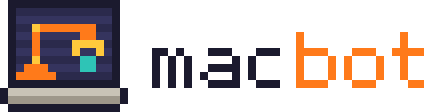
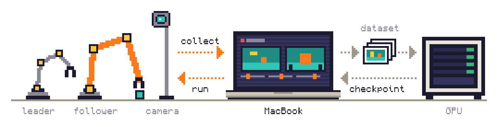
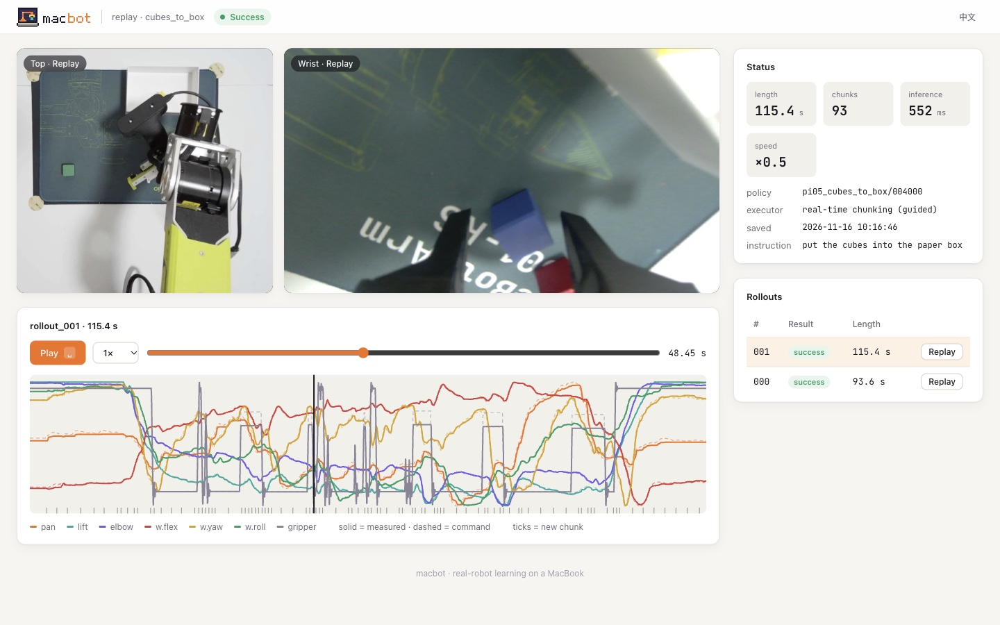

<p align="center">
  <picture>
    <source media="(prefers-color-scheme: dark)" srcset="https://raw.githubusercontent.com/MuQY1818/macbot/main/assets/logo-dark.svg">
    
  </picture>
</p>

<p align="center"><b>LeRobot on a MacBook.</b><br>
Record demonstrations and run LeRobot policies on a real arm, straight from an Apple silicon Mac.</p>

<p align="center">
  
  
  
  
  <a href="https://github.com/MuQY1818/macbot/actions/workflows/test.yml"></a>
</p>

<p align="center"><b>English</b> · <a href="https://github.com/MuQY1818/macbot/blob/main/README_zh.md">中文</a></p>

<p align="center">
  <picture>
    <source media="(prefers-color-scheme: dark)" srcset="https://raw.githubusercontent.com/MuQY1818/macbot/main/assets/scene-dark.svg">
    
  </picture>
</p>

## Getting started

```bash
pip install macbot
macbot init        # pick the arms and cameras in your browser
macbot collect     # record demonstrations
```

The [quickstart](docs/quickstart.md) walks through the first recording. If you already use LeRobot on Linux,
`macbot init --from-lerobot` takes your `lerobot-record` command and the [migration guide](docs/migrate.md) covers
the rest. You need Python 3.12 or later.

macbot reads and writes plain LeRobot formats, so nothing gets locked in. A full round looks like this:

```bash
macbot collect                               # record
macbot health                                # check the episodes
macbot export --out ./dataset                # LeRobot v3.0 dataset
# train with lerobot-train on a GPU machine, then copy the checkpoint back
macbot run --policy ./pretrained_model       # or owner/model@revision from the Hub
macbot replay                                # review the trials
```

## Speed

Time per action chunk on a MacBook Pro (M5 Pro, 48 GB):

| Policy | Execution | PyTorch MPS | MLX |
|---|---|---:|---:|
| π0.5 | chunk 50 | 270 ms | **165 ms** |
| π0.5 | RTC 50 | 350 ms | **170 ms** |
| SmolVLA | chunk 50 | 296 ms | **53 ms** |
| X-VLA | chunk 30 | 178 ms | **138 ms** |
| ACT | chunk 100 | 16 ms | **8 ms** |

Pass `--backend auto` to `macbot run` to use MLX where it has been checked against PyTorch. We measured on recorded
observations with an SO-101 π0.5 fine-tune and public SmolVLA, X-VLA and ACT checkpoints, using 10 denoising steps
for the VLAs. [Acceleration](docs/acceleration.md) has the error numbers and exact settings, and
[Policies](docs/policies.md) lists every supported policy. π0.5 needs at least 32 GB of memory.

Teleoperation runs at 60 Hz and recording at 30 fps. When a frame is sampled, the camera image is at most 40 ms old
(p95).

<p align="center"></p>

| Run a policy | Replay a trial |
|---|---|
|  |  |

## Hardware

We test on a Seeed reBot B601-RS. SO-100/101, Koch and OMX arms run through their LeRobot drivers, but so far only
with simulated hardware, so reports from real arms are very welcome. The SO-101
[simulation](docs/simulation.md) runs the whole workflow, although no trained policy solves its task yet.
[Robots](docs/robots.md) lists what each profile has been tested on.

A few things needed extra care on macOS. The reference setup runs under sudo for its Orbbec camera, and sudo drops
the library path, so macbot loads the PCBUSB CAN driver itself and gives recorded files back to your user. macOS also
likes to offer a nearby iPhone as a camera, so macbot picks cameras by their unique ID instead of by name or index.

## Contributing

Bug reports, hardware reports and pull requests are welcome. [CONTRIBUTING](CONTRIBUTING.md) explains the
development setup, [Architecture](docs/architecture.md) the code layout, and the [roadmap](ROADMAP.md) what comes
next.

## Safety

macbot moves a real arm. Every console starts paused or idle, limits joint speed and range, clamps the
gripper force, pauses when a camera stalls, and returns to zero slowly before disabling the motors. Keep the
workspace clear and a hand near the power switch, and start new policies at `--speed 0.3`.

## Acknowledgements

Built on [LeRobot](https://github.com/huggingface/lerobot). π0.5 and the augmentation recipe come from
[openpi](https://github.com/Physical-Intelligence/openpi); Real-Time Chunking from Black et al., 2025.
The reBot arms are by [Seeed Studio](https://github.com/Seeed-Projects). JetBrains Mono is under the SIL
Open Font License.

## License

Apache-2.0. See [LICENSE](https://github.com/MuQY1818/macbot/blob/main/LICENSE).
