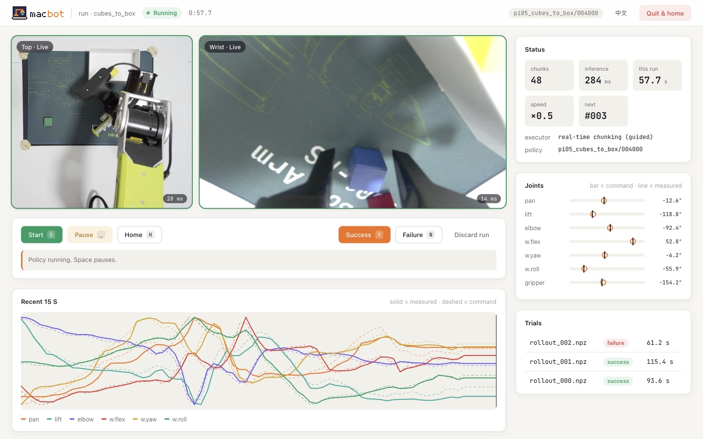

<p align="center">
  <picture>
    <source media="(prefers-color-scheme: dark)" srcset="https://raw.githubusercontent.com/MuQY1818/macbot/main/assets/logo-dark.svg">
    
  </picture>
</p>

<p align="center"><b>Real-robot learning on a MacBook.</b><br>
Teleoperate, record, export to LeRobot and run ACT or π0.5 on the robot, all from a Mac on Apple silicon.</p>

<p align="center">
  
  
  
  
  <a href="https://github.com/MuQY1818/macbot/actions/workflows/test.yml"></a>
</p>

<p align="center"><b>English</b> · <a href="https://github.com/MuQY1818/macbot/blob/main/README_zh.md">中文</a></p>

<p align="center"></p>

## Why

Real-robot setups usually assume an Ubuntu workstation with an NVIDIA GPU next to the arm. We found a
MacBook is enough for everything that happens at the robot: teleoperated data collection, data checks,
export to LeRobot, and closed-loop policy inference, π0.5 included. Training still goes to a GPU machine.
macbot is the toolkit we use for that, cleaned up so others can reuse it.

Measured on a MacBook Pro (M5 Pro, 48 GB), PyTorch MPS:

| Measurement | Result |
|---|---|
| π0.5 inference, 50-step action chunk, 10 denoising steps | **~280 ms** (bf16 + `torch.compile`) |
| π0.5 with Real-Time Chunking guidance | **~350 ms** |
| ACT inference, 100-step chunk | **~25 ms** |
| Teleoperation loop / recording grid | 60 Hz / 30 fps |
| Camera frame age at sampling time, p95 | **≤ 40 ms** (scene UVC + wrist Orbbec) |

## What is inside

- **Collection console** in the browser: live cameras, one-key record / save / discard, per-episode language
  instruction, automatic quality checks (frame age, repeated frames, joint jumps, timing), instant replay of
  any episode with joint traces.
- **Export** to a LeRobot v3 dataset, optionally with a binary (open / closed) gripper action.
- **Policy runner** console for ACT and π0.5 with four execution schemes (synchronous chunks, temporal
  ensembling, asynchronous chunks, Real-Time Chunking), velocity and joint limits, pause / home / quit with a
  slow two-stage return to zero, and every trial saved with video and timing.
- **Replay** of saved trials (all cameras in sync, command vs. measured traces, chunk boundaries) and
  side-by-side **MP4** export.
- **`macbot doctor`** checks packages, MPS and the configured robot and cameras before you start.
- **`--fake`** on `collect` and `run` substitutes a fake arm and cameras; `run` still runs the policy.
- English and Chinese in every web page (toggle in the top bar), light and dark mode.

| Run a policy | Replay a trial |
|---|---|
|  |  |

## Hardware

The reBot B601-RS is the reference arm tested on hardware. See [robot support](docs/robots.md)
for the SO-100/101 and other compatible LeRobot arms, the local simulator, and what has been
verified. The [setup guide](docs/setup.md) covers drivers and cameras. For π0.5, we recommend
an Apple silicon Mac with at least 32 GB of memory.

## Quick start

```bash
conda create -n macbot python=3.12 -y && conda activate macbot
pip install "macbot[orbbec,pi]"        # drop pi if you only use ACT
# or from source: git clone https://github.com/MuQY1818/macbot && pip install -e "./macbot[orbbec,pi]"

macbot doctor                          # what is ready, what is missing
macbot collect --fake                  # the collection console with a simulated arm and cameras
```

Open <http://127.0.0.1:8766>. Press **S** to record, **Enter** to save, **←** to discard.
For MuJoCo, use `pip install -e '.[sim]'` in the source checkout, then
`macbot --config configs/so101_sim.yaml collect`. For hardware, follow [setup](docs/setup.md).

## Workflow

```bash
sudo -E $(which python) -m macbot.cli collect          # 1. teleoperate and record (sudo: Orbbec SDK)
macbot health                                          # 2. per-episode tracking and timing report
macbot export --gripper binary                         # 3. LeRobot dataset in ~/macbot-data/datasets/
DATASET=... ./train/train_pi05.sh my_run               # 4. train on a GPU machine (train_act.sh for ACT)
sudo -E $(which python) -m macbot.cli run --policy runs/my_run/checkpoints/last/pretrained_model
macbot replay                                          # 5. browse trials;  macbot video <rollout.npz> for an MP4
```

The full walkthrough, including the data format and the execution schemes, is in [docs/guide.md](https://github.com/MuQY1818/macbot/blob/main/docs/guide.md).
Put your settings in a YAML file and pass `macbot --config my.yaml <command>`; anything you leave out falls
back to [macbot/default.yaml](https://github.com/MuQY1818/macbot/blob/main/macbot/default.yaml). [configs/example.yaml](https://github.com/MuQY1818/macbot/blob/main/configs/example.yaml) is a starting point.

## What it took to run this on macOS

- **CAN under sudo.** The Orbbec SDK needs root, and dyld ignores `/usr/local/lib` for root processes, so
  `libPCBUSB.dylib` is preloaded explicitly before the CAN backend looks for it.
- **The right camera.** Opening a UVC camera by name or index can grab an iPhone through Continuity
  Camera. macbot opens cameras by AVFoundation uniqueID through a small Swift helper, and still finds the
  camera when it moves to another USB port.
- **π0.5 on MPS.** bf16 weights under autocast; the masked third camera slot is skipped (identical output,
  ~70 ms saved); `torch.compile` on the denoising step and the language model cuts per-kernel dispatch
  overhead (~410 → ~280 ms); the random weight initialization that the checkpoint overwrites anyway is
  skipped, which saves about 80 s per load.
- **Optional π0.5 on MLX.** See the [inference benchmarks](docs/acceleration.md) for recorded-observation
  latency, action fidelity, and the checkpoint requirements.
- **Files written as root** are handed back to the user who ran `sudo`.

## Contributing

See [CONTRIBUTING](CONTRIBUTING.md) for development and hardware reports,
[architecture](docs/architecture.md) for the code layout, and the [roadmap](ROADMAP.md) for planned work.

## Safety

macbot moves a real arm. Every console starts paused or idle, limits joint speed and range, clamps the
gripper force, pauses when a camera stalls, and returns to zero slowly before disabling the motors. Keep the
workspace clear and a hand near the power switch, and start new policies at `--speed 0.3`.

## Acknowledgements

Built on [LeRobot](https://github.com/huggingface/lerobot). π0.5 and the augmentation recipe come from
[openpi](https://github.com/Physical-Intelligence/openpi); Real-Time Chunking from Black et al., 2025.
The reBot arms are by [Seeed Studio](https://github.com/Seeed-Projects). JetBrains Mono is under the SIL
Open Font License.

## License

Apache-2.0. See [LICENSE](https://github.com/MuQY1818/macbot/blob/main/LICENSE).
