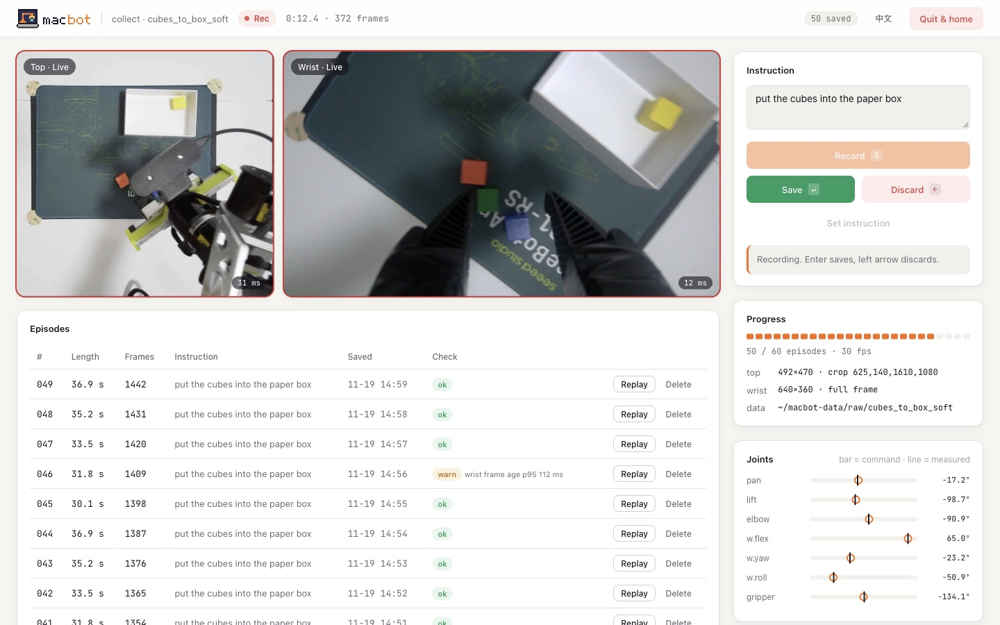

<p align="center">
  <picture>
    <source media="(prefers-color-scheme: dark)" srcset="https://raw.githubusercontent.com/MuQY1818/macbot/main/assets/logo-dark.svg">
    
  </picture>
</p>

<p align="center"><b>LeRobot on a MacBook.</b><br>
Bring your LeRobot arms, calibration, datasets and checkpoints to a MacBook.</p>

<p align="center">
  
  
  
  
  <a href="https://github.com/MuQY1818/macbot/actions/workflows/test.yml"></a>
</p>

<p align="center"><b>English</b> · <a href="https://github.com/MuQY1818/macbot/blob/main/README_zh.md">中文</a></p>

<p align="center">
  <picture>
    <source media="(prefers-color-scheme: dark)" srcset="https://raw.githubusercontent.com/MuQY1818/macbot/main/assets/scene-dark.svg">
    
  </picture>
</p>

## Start here

Already using LeRobot on Linux? Follow the [migration guide](docs/migrate.md) to reuse your
calibration and import your command. Setting up from scratch? See the [quickstart](docs/quickstart.md).
macbot handles Mac device setup; LeRobot datasets and checkpoints move between machines as-is.

```bash
macbot doctor
macbot init --from-lerobot "$LEROBOT_COMMAND"   # your lerobot-record or lerobot-teleoperate command
macbot collect
macbot health
macbot export --out ./dataset
# Train with lerobot-train on a GPU machine, then bring the checkpoint back.
macbot run --policy ./pretrained_model       # or owner/model@revision
macbot replay
```

See [robot support](docs/robots.md) for hardware and simulator evidence, and
[policy support](docs/policies.md) for tested checkpoints. Try `collect --fake` without an arm.

Measured on a MacBook Pro (M5 Pro, 48 GB). Approximate time per action chunk:

| Policy | Chunk | PyTorch MPS | MLX |
|---|---:|---:|---:|
| π0.5 | 50 | 270 ms | **165 ms** |
| π0.5 with RTC | 50 | 350 ms | **170 ms** |
| SmolVLA | 50 | 300 ms | — |
| X-VLA | 30 | 235 ms | — |
| ACT | 100 | 25 ms | — |

π0.5 runs 10 denoising steps, in bf16 with `torch.compile` on PyTorch and in fp16 with `--backend mlx`. The
MLX actions match PyTorch within 0.1° on average. RTC is Real-Time Chunking guidance. SmolVLA is the official
base checkpoint and X-VLA the SO-101 fine-tune. Method and full results are in
[docs/acceleration.md](https://github.com/MuQY1818/macbot/blob/main/docs/acceleration.md), other policies in
[docs/policies.md](https://github.com/MuQY1818/macbot/blob/main/docs/policies.md).

| Data collection | Measured |
|---|---:|
| Teleoperation loop | 60 Hz |
| Recording | 30 fps |
| Camera frame age at sampling, p95 | ≤ 40 ms |

<p align="center"></p>

Use `health --dataset` and `replay --dataset` to inspect existing LeRobot v3.0 data in place,
including Hub datasets. The [workflow guide](docs/guide.md) covers collection, policy execution,
and trial review. See [setup](docs/setup.md) for camera permissions and the reference reBot CAN driver.

## Contributing

See [CONTRIBUTING](CONTRIBUTING.md) for development and hardware reports,
[architecture](docs/architecture.md) for the code layout, and the [roadmap](ROADMAP.md) for planned work.

## Safety

macbot moves a real arm. Every console starts paused or idle, limits joint speed and range, clamps the
gripper force, pauses when a camera stalls, and returns to zero slowly before disabling the motors. Keep the
workspace clear and a hand near the power switch, and start new policies at `--speed 0.3`.

## Acknowledgements

Built on [LeRobot](https://github.com/huggingface/lerobot). π0.5 and the augmentation recipe come from
[openpi](https://github.com/Physical-Intelligence/openpi); Real-Time Chunking from Black et al., 2025.
The reBot arms are by [Seeed Studio](https://github.com/Seeed-Projects). JetBrains Mono is under the SIL
Open Font License.

## License

Apache-2.0. See [LICENSE](https://github.com/MuQY1818/macbot/blob/main/LICENSE).
