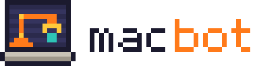
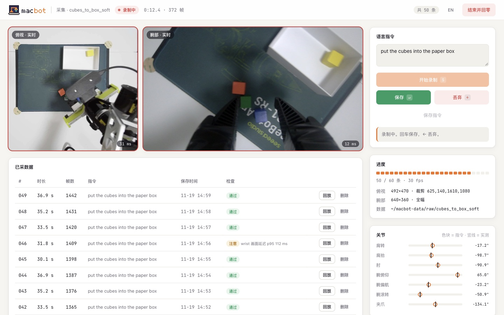
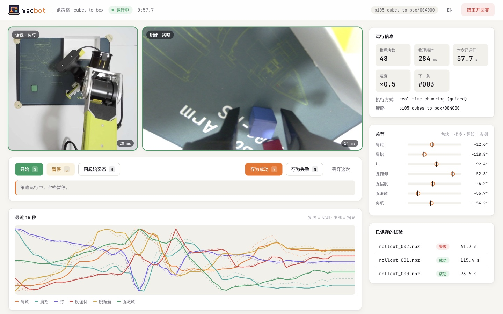
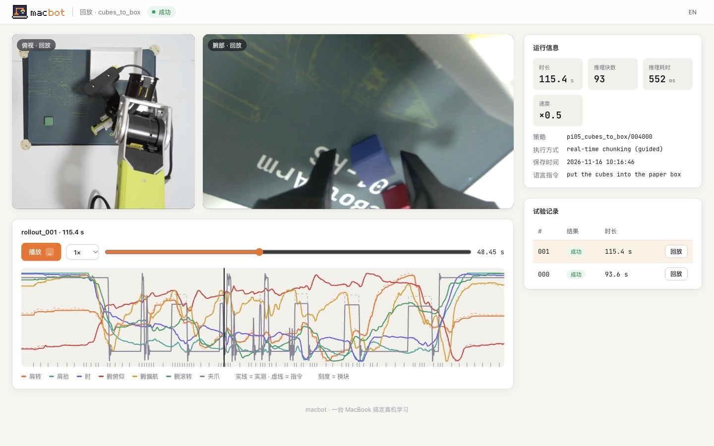

<p align="center">
  <picture>
    <source media="(prefers-color-scheme: dark)" srcset="https://raw.githubusercontent.com/MuQY1818/macbot/main/assets/logo-dark.svg">
    
  </picture>
</p>

<p align="center"><b>一台 MacBook 搞定真机学习。</b><br>
遥操作采数据、导出 LeRobot 数据集、在真机上跑 ACT 和 π0.5，全部在 Apple 芯片的 Mac 上完成。</p>

<p align="center">
  
  
  
  
  <a href="https://github.com/MuQY1818/macbot/actions/workflows/test.yml"></a>
</p>

<p align="center"><a href="https://github.com/MuQY1818/macbot/blob/main/README.md">English</a> · <b>中文</b></p>

<p align="center"></p>

## 为什么做这个

做真机实验时，大家通常默认机械臂旁边要放一台装 Ubuntu、插 NVIDIA 显卡的工作站。我们发现，机械臂旁边的工作一台 MacBook 就够了：遥操作采数据、检查数据、导出 LeRobot 数据集，以及闭环跑策略，包括 π0.5。训练仍然放在 GPU 服务器上。macbot 就是我们日常用的这套工具，整理之后开源出来，方便大家复用。

以下数据在 MacBook Pro（M5 Pro，48 GB）上用 PyTorch MPS 实测：

| 项目 | 实测 |
|---|---|
| π0.5 推理（动作块 50 步，去噪 10 步） | **约 280 ms**（bf16 + `torch.compile`） |
| π0.5 走可选的 MLX 后端（`--backend mlx`，fp16，动作误差 0.1° 以内） | **约 165 ms** |
| π0.5 加 Real-Time Chunking 引导 | **约 350 ms** |
| ACT 推理（动作块 100 步） | **约 25 ms** |
| 遥操作控制频率 / 录制采样频率 | 60 Hz / 30 fps |
| 采样时刻的画面延迟 p95 | **≤ 40 ms**（俯视 UVC + 腕部 Orbbec） |

## 功能

- **采集控制台**（网页）：实时画面；一键录制、保存、丢弃；每条数据单独记录语言指令；保存时自动检查画面延迟、重复帧、关节跳变和采样时序；任何一条都能立即回放，带关节曲线。
- **导出**为 LeRobot v3 数据集，夹爪动作可以选择二值化（张开或闭合）。
- **跑策略控制台**：支持 ACT 和 π0.5，提供四种执行方式（同步分块、时间集成、异步分块、Real-Time Chunking）。带速度和关节限位；可以暂停、回起始姿态、结束时分两段慢速回零；每次试验连同画面和时序一起保存。
- **试验回放**：多路画面同步播放，显示指令与实测曲线和换块位置，也能导出左右并排的 **MP4**。
- **`macbot doctor`**：开工前检查依赖、MPS 和配置中的机械臂与相机。
- `collect` 和 `run` 支持 **`--fake`**，使用 fake 机械臂和相机；`run` 仍会运行真实策略。
- 每个网页都有中英文（顶栏切换），支持浅色和深色模式。

| 跑策略 | 回放试验 |
|---|---|
|  |  |

## 硬件

reBot B601-RS 是已验证真机的参考机械臂。SO-100/101、其他兼容的 LeRobot 机械臂、本地模拟器
及其验证状态见[机械臂支持](docs/robots_zh.md)；驱动和相机配置见[安装指南](docs/setup_zh.md)。
运行 π0.5 建议使用至少 32 GB 内存的 Apple 芯片 Mac。

## 快速开始

```bash
conda create -n macbot python=3.12 -y && conda activate macbot
pip install "macbot[orbbec,pi]"        # 只用 ACT 可以去掉 pi
# 或者从源码装：git clone https://github.com/MuQY1818/macbot && pip install -e "./macbot[orbbec,pi]"

macbot doctor                          # 看看哪些就绪、缺什么
macbot collect --fake                  # 用模拟机械臂和相机打开采集控制台
```

打开 <http://127.0.0.1:8766>。按 **S** 录制，**回车** 保存，**←** 丢弃。
使用 MuJoCo 时，在源码目录执行 `pip install -e '.[sim]'`，再运行 `macbot --config configs/so101_sim.yaml collect`。连接真机请参照[安装指南](docs/setup_zh.md)。

## 工作流程

```bash
sudo -E $(which python) -m macbot.cli collect          # 1. 遥操作录数据（Orbbec SDK 需要 sudo）
macbot health                                          # 2. 逐条看跟踪误差和采样时序
macbot export --gripper binary                         # 3. 导出到 ~/macbot-data/datasets/
DATASET=... ./train/train_pi05.sh my_run               # 4. 在 GPU 服务器上训练（ACT 用 train_act.sh）
sudo -E $(which python) -m macbot.cli run --policy runs/my_run/checkpoints/last/pretrained_model
macbot replay                                          # 5. 回放试验；macbot video <rollout.npz> 导出 MP4
```

完整说明（含数据格式和各执行方式）见 [docs/guide_zh.md](https://github.com/MuQY1818/macbot/blob/main/docs/guide_zh.md)。
自己的设置写在一个 YAML 里，用 `macbot --config my.yaml <命令>` 传入，没写的项沿用 [macbot/default.yaml](https://github.com/MuQY1818/macbot/blob/main/macbot/default.yaml)。可以从 [configs/example.yaml](https://github.com/MuQY1818/macbot/blob/main/configs/example.yaml) 开始改。

## 在 macOS 上跑起来要解决的问题

- **sudo 下的 CAN。** Orbbec SDK 要 root 权限，而 root 进程的 dyld 不搜索 `/usr/local/lib`，所以要在 CAN 后端加载之前手动预载 `libPCBUSB.dylib`。
- **打开正确的相机。** 按名字或编号打开 UVC 相机，可能会抓到通过“连续互通相机”连上的 iPhone。macbot 用一个 Swift 小程序按 AVFoundation uniqueID 打开相机，相机换了 USB 口也能找到。
- **π0.5 跑在 MPS 上。** 权重用 bf16 并开 autocast；跳过被遮掉的第三个相机槽（输出完全一致，省约 70 ms）；对去噪步和语言模型做 `torch.compile`，减少逐个 kernel 派发的开销（约 410 → 280 ms）；跳过反正会被权重覆盖的随机初始化，每次加载省约 80 秒。
- **可选的 π0.5 MLX 后端。** 录制观测上的延迟、动作误差和 checkpoint 要求见[推理基准](https://github.com/MuQY1818/macbot/blob/main/docs/acceleration_zh.md)。
- **root 写出的文件**会交还给运行 `sudo` 的用户。

## 参与贡献

开发与真机报告见[贡献指南](CONTRIBUTING_zh.md)，代码布局见[架构](docs/architecture_zh.md)，
后续工作见[路线图](ROADMAP_zh.md)。

## 安全

macbot 会驱动真实的机械臂。所有控制台启动时都处于暂停或待机状态；会限制关节速度和范围、限制夹爪夹紧力；相机断流时自动暂停；退出时先慢速回零再让电机失能。请保持工作区域无人、手边留着电源开关；新策略先用 `--speed 0.3` 跑。

## 致谢

基于 [LeRobot](https://github.com/huggingface/lerobot)。π0.5 和图像增强配方来自 [openpi](https://github.com/Physical-Intelligence/openpi)，Real-Time Chunking 来自 Black 等人（2025）。reBot 机械臂由 [Seeed Studio](https://github.com/Seeed-Projects) 设计。JetBrains Mono 字体采用 SIL Open Font License。

## 许可证

Apache-2.0，见 [LICENSE](https://github.com/MuQY1818/macbot/blob/main/LICENSE)。
