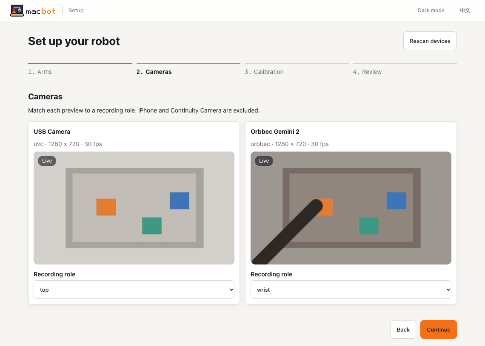

# First recording on a Mac

[简体中文](quickstart_zh.md)

Start with an assembled SO-100/101, Koch, OMX, or reBot B601-RS pair and at least one camera. The wizard
can identify supported USB adapters, but it cannot discover the arm model or provision individual motors.
Follow the kit's assembly and motor ID setup first. See [robot support](robots.md) for what's been tested.

1. Install Python 3.12 on your Apple silicon Mac (for example, with the Python.org installer). For a UVC
   webcam, run `xcode-select --install` and let the installation finish. In Terminal, create and activate
   an environment:

   ```bash
   python3.12 -m venv ~/.venvs/macbot
   source ~/.venvs/macbot/bin/activate
   ```

2. Connect and power the arms and plug in the cameras. Start setup:

   ```bash
   pip install macbot
   macbot init
   ```

   Confirm the arm model. To distinguish identical adapters, click **Identify by movement**, then gently
   move only the leader by hand with its torque disabled. If the result is unclear, unplug one USB cable, rescan to
   identify the remaining adapter, reconnect, and assign the roles manually. Replugging devices with
   unique USB serial numbers into new sockets preserves their roles. Adapters without unique serials
   are tied to their selected port; keep them in those sockets and re-run setup if you change the wiring.

3. Assign camera roles from the live previews. Grant camera access in macOS when prompted. The wizard
   excludes iPhone and Continuity Camera and picks a supported capture mode for each camera. Re-run setup
   if a UVC camera's unique ID changes after switching sockets.

   

4. For missing calibration, run the command shown for each arm in a separate Terminal with the same
   environment active. If needed, install `pip install 'lerobot[core-scripts]==0.7.0'` there first.
   Follow LeRobot's prompts and move the joints by hand. LeRobot saves the files in its normal calibration
   folder. Return to the wizard, click **Check again**, then **Save and run doctor**. The wizard only reads
   calibration files; the separate LeRobot command handles calibration.

5. Support the follower, clear the workspace, and match the poses of the arms. Click **Start collection**
   or stop the wizard with **Ctrl+C** and run:

   ```bash
   macbot collect
   ```

   Open the collection link in the wizard or the URL printed in Terminal, and wait for the teleoperation
   status. Move the leader to verify tracking.
   Press **S**, demonstrate the task for at least two seconds, and press **Enter** to save (**←** discards).
   The first episode appears in the console and under `~/macbot-data/raw/cubes_to_box/`. Use the console's
   quit control before disconnecting the arms.

The default profile is `~/.config/macbot/config.yaml`; `macbot --config other.yaml collect` still uses that
explicit file. To try the console without hardware, run `macbot collect --fake`.

Policies must run with the camera framing they were trained with: the same capture mode, crop, and saved
image size for each role. When migrating, use `macbot init --from existing.yaml` and keep **Keep framing from
the existing config** selected. Exports store `meta/camera_framing.json`; the training scripts copy it into
checkpoints. `macbot run` stops before connecting to the robot if known framing differs, unless you explicitly
pass `--allow-framing-mismatch`. With older checkpoints that lack this information, verify the framing printed at startup.

The consoles default to ports 8765 (init), 8766 (collect), 8767 (run), and 8768 (replay). A busy default
falls back to the next available port, up to nine ports higher. To fix the port, pass `--port` or set
`init.port`, `teleop.port`, `run.port`, or `replay.port` in YAML. An explicit port must be available.

For an existing calibrated setup, `macbot init --yes` reuses the saved roles and runs doctor. For a fresh serial
pair, scripts can confirm the setup with `--family so101 --leader-serial … --follower-serial …`; one external
camera is assigned to `top`. If any role or model is ambiguous or calibration is missing, use the wizard.

For **reBot**, install PCBUSB and follow the [reference procedure](setup.md#2-can-driver-pcan-usb). The wizard
recognizes the standard PCAN-USB, uses `can0`, and keeps the reference calibration IDs. For **Orbbec**, install
the SDK before setup. On Python 3.12/3.13 its current PyPI package pins a PyAV version incompatible with
LeRobot 0.7.0; for color streaming, install macbot first, then `pip install --no-deps pyorbbecsdk2==2.1.3`
in the same environment. If the SDK requires root, run setup and collection from that environment like this:

```bash
export HF_LEROBOT_CALIBRATION="$(python -c 'from lerobot.utils.constants import HF_LEROBOT_CALIBRATION; print(HF_LEROBOT_CALIBRATION)')"
sudo -E "$(command -v macbot)" init
sudo -E "$(command -v macbot)" collect
```

Calibrate from your normal user account. The environment setting points both instances to the same
LeRobot calibration directory.
