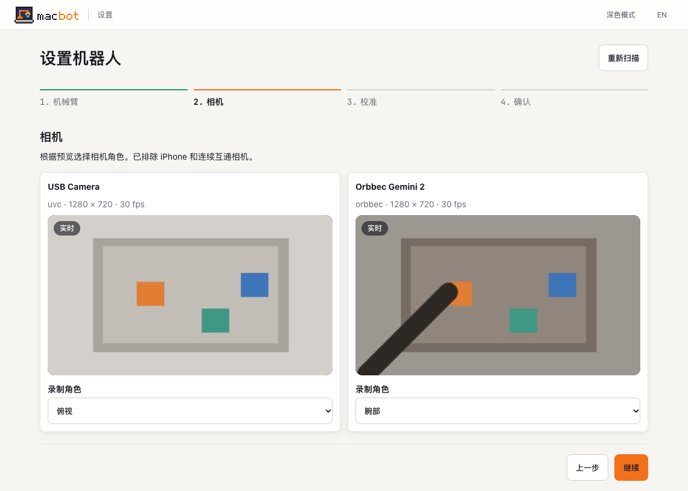

# 快速开始

[English](quickstart.zh.md)

本页带你从一对组装好的主从臂开始，录下第一条示范。

!!! note "开始之前"

    - 一台 Apple 芯片的 Mac。
    - 一对组装好的主从臂：SO-100/101、Koch、OMX 或 reBot B601-RS。请先按套件说明完成组装和电机 ID 设置。macbot 能识别 USB 适配器，但不会设置电机 ID。已经实测过的机械臂见[机械臂](robots.zh.md)。
    - 至少一台相机。
    - 用 reBot 或 Orbbec 相机？先看[特殊硬件](#特殊硬件)里的额外步骤。

## 1. 安装

安装 Python 3.12，例如用 python.org 的安装包。使用 UVC 相机时，再执行一次 `xcode-select --install`。然后创建环境并安装 macbot：

```bash
python3.12 -m venv ~/.venvs/macbot
source ~/.venvs/macbot/bin/activate
pip install macbot
```

## 2. 运行配置向导

连接两只机械臂并接通电源，插好相机，然后启动向导：

```bash
macbot init
```

向导会在浏览器中打开。先确认机械臂型号，再区分主从臂：点击**通过动作识别**，然后用手轻轻移动主臂，保持从臂不动。主臂未使能，可以直接推动。

??? tip "向导分不清两只机械臂"

    拔掉其中一条 USB 线并重新扫描，剩下的适配器就是另一只臂。把线插回去，再手动指定主从臂。

    有唯一 USB 序列号的适配器换到任何接口都保留角色。没有序列号的适配器绑定在你选定的接口上，请不要换口，换线后重新运行向导。

## 3. 分配相机

根据实时预览给每台相机选择角色，macOS 提示时授予相机权限。向导会跳过 iPhone 和连续互通相机，并为每台相机选择它支持的画面模式。



如果 UVC 相机换了接口后 ID 改变，请重新运行向导。

## 4. 按提示标定

macbot 读取 LeRobot 的标定文件，但自己不做标定。缺少标定文件时，向导会为每只臂给出一条 LeRobot 命令。

1. 另开一个终端，激活同一个环境，运行这条命令。如果提示缺少依赖，先执行 `pip install 'lerobot[core-scripts]==0.7.0'`。
2. 按 LeRobot 的提示用手移动各关节。标定文件会保存在 LeRobot 的默认标定目录。
3. 回到向导，点击**重新检查**，再点击**保存并运行检查**。

## 5. 录制第一条示范

托住从臂，清空工作区，把两只臂摆成相同的姿态。在向导里点击**启动采集**，或者按 ++ctrl+c++ 退出向导后运行：

```bash
macbot collect
```

采集控制台会在浏览器中打开。等页面显示遥操作已启动后，移动主臂，确认从臂跟随。

| 按键 | 作用 |
|---|---|
| ++s++ | 开始录制 |
| ++enter++ | 保存这条示范 |
| ++arrow-left++ | 丢弃这条示范 |

每条至少录两秒。保存的示范会出现在控制台中，并写入 `~/macbot-data/raw/cubes_to_box/`。拔掉机械臂之前，请先在控制台里退出。

手边没有硬件？`macbot collect --fake` 会用模拟的机械臂和相机打开同一个控制台。

## 下一步

- 检查、导出并训练：[工作流程](guide.zh.md)。
- 在机器人上运行训练好的策略：[运行策略](guide.zh.md#5-运行策略)。
- 让策略在 Mac 上跑得更快：[加速](acceleration.zh.md)。

## 保持相机取景

!!! warning "策略必须使用训练时的取景"

    录制和运行时，每个相机角色的画面模式、裁剪范围和保存尺寸都要保持一致。

导出时取景会写入 `meta/camera_framing.json`，训练脚本会把它复制进权重目录。取景不一致时，`macbot run` 会在连接机器人之前停止。只有确认差异不影响策略时，才传入 `--allow-framing-mismatch`。旧权重没有取景记录，请把 `macbot run` 启动时打印的取景和训练时的取景对照一下。

把已有配置迁移到 macbot 时，运行 `macbot init --from existing.yaml`，并保持选中**保留现有配置的取景**。

## 特殊硬件

??? note "reBot B601-RS（PCAN-USB）"

    按[环境配置](setup.zh.md#can-驱动pcan-usb)安装 PCBUSB 驱动。向导能识别标准的 PCAN-USB 适配器，使用 `can0`，并保留参考配置里的标定 ID。

??? note "Orbbec 相机"

    运行向导之前先安装 Orbbec SDK。它目前在 PyPI 上的包固定了一个 PyAV 版本，在 Python 3.12 和 3.13 上与 LeRobot 0.7.0 冲突。只用彩色流时，先装 macbot，再在同一环境中运行：

    ```bash
    pip install --no-deps pyorbbecsdk2==2.1.3
    ```

    如果 SDK 需要 root 权限，用 sudo 运行向导和采集，并让它们使用你自己的标定目录：

    ```bash
    export HF_LEROBOT_CALIBRATION="$(python -c 'from lerobot.utils.constants import HF_LEROBOT_CALIBRATION; print(HF_LEROBOT_CALIBRATION)')"
    sudo -E "$(command -v macbot)" init
    sudo -E "$(command -v macbot)" collect
    ```

    标定命令请用普通用户运行。

## 参考

??? note "配置文件"

    向导把配置保存在 `~/.config/macbot/config.yaml`。`macbot --config other.yaml collect` 会改用指定的文件。

??? note "浏览器标签页和端口"

    各控制台会在默认浏览器中打开，用 sudo 运行时也一样。上次留下的控制台标签页会自动刷新，不会新开一个，所以多次 `macbot run` 共用同一个标签页。只想打印地址时，传入 `--no-browser` 或设置 `MACBOT_NO_BROWSER=1`。

    默认端口是 init 8765、collect 8766、run 8767、replay 8768。默认端口被占用时，macbot 会向上尝试最多九个端口。要固定端口，传入 `--port`，或在配置里设置 `init.port`、`teleop.port`、`run.port`、`replay.port`。显式指定的端口必须空闲。

??? note "不用向导的配置方式"

    已经标定并有配置时，`macbot init --yes` 会复用保存的角色并运行检查。新的串口主从臂可以在脚本里用 `--family so101 --leader-serial … --follower-serial …` 确认配置，只有一台外置相机时它会被设为 `top`。型号或角色不明确、或者缺少标定时，请使用向导。
