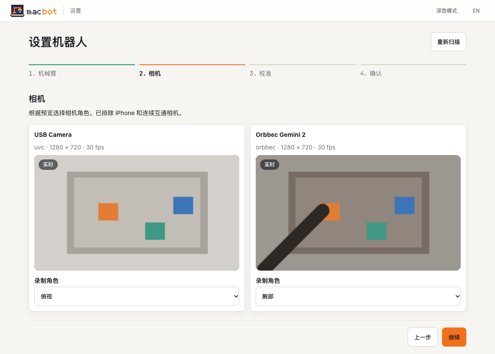

# 在 Mac 上录制第一条示范

[English](quickstart.md)

准备已组装的 SO-100/101、Koch、OMX 或 reBot B601-RS 主从臂，以及至少一台相机。向导能识别常见
USB 适配器，机械臂型号仍需确认。请先按套件说明完成组装与电机 ID 设置。实机验证范围见[机械臂支持](robots_zh.md)。

1. 在 Apple 芯片 Mac 上安装 Python 3.12（例如用 Python.org 安装包）。使用 UVC 相机时，执行
   `xcode-select --install` 并等安装完成。在终端创建并激活环境：

   ```bash
   python3.12 -m venv ~/.venvs/macbot
   source ~/.venvs/macbot/bin/activate
   ```

2. 连接机械臂并接通电源，插好相机，然后启动向导：

   ```bash
   pip install macbot
   macbot init
   ```

   确认机械臂型号。要区分相同的适配器，点击**通过动作识别**，再轻轻移动未使能的主臂，保持从臂不动。
   若无法区分，拔掉其中一条 USB 线并重新扫描，认出剩下的适配器后再接回去，手动选择主从臂。
   有唯一 USB 序列号的设备换口后仍保留角色；没有唯一序列号的设备请留在选定接口，换线后重新设置。

3. 根据实时预览分配相机角色。macOS 提示时授予相机权限。向导会排除 iPhone 和连续互通相机，并选择设备
   支持的画面模式。如果 UVC 相机换口后唯一 ID 改变，请重新运行向导。

   

4. 若缺少校准文件，在另一个终端激活同一环境，运行页面给出的命令。若校准命令缺依赖，先执行
   `pip install 'lerobot[core-scripts]==0.7.0'`。按 LeRobot 提示手动移动关节；文件会保存到
   LeRobot 的标准校准目录。返回页面点**重新检查**，然后点**保存并运行检查**。向导只检查校准文件，
   校准操作由单独运行的 LeRobot 命令处理。

5. 托住从臂，清空工作区，将两臂对齐。点击**启动采集**，或用 **Ctrl+C** 退出向导后运行：

   ```bash
   macbot collect
   ```

   打开向导里的采集链接或终端显示的地址，等页面显示遥操作已启动，再移动主臂确认跟随。按 **S**，示范至少两秒，
   按**回车**保存（**←** 丢弃）。第一条数据会显示在控制台，并保存到 `~/macbot-data/raw/cubes_to_box/`。
   拔掉机械臂前，请先用控制台的退出按钮结束采集。

默认配置保存在 `~/.config/macbot/config.yaml`；显式传入 `macbot --config other.yaml collect` 时优先
使用指定文件。没有硬件时可以运行 `macbot collect --fake` 试用采集台。

运行策略时必须沿用训练时的相机取景：各角色的采集模式、裁剪范围和保存尺寸都应一致。迁移旧配置时用
`macbot init --from existing.yaml`，保持选中**保留现有配置的取景**。导出会写入
`meta/camera_framing.json`，训练脚本会把它放进 checkpoint。若已记录的取景不一致，`macbot run`
会在连接机械臂前停止，除非显式传入 `--allow-framing-mismatch`。旧 checkpoint 缺少取景信息时，
请核对启动时打印的当前取景。

`init`、`collect`、`run`、`replay` 的默认端口分别是 8765、8766、8767、8768。默认端口被占用时，
会向上尝试最多九个端口。要固定端口，请传入 `--port` 或在 YAML 中设置 `init.port`、`teleop.port`、
`run.port`、`replay.port`；显式指定的端口必须可用。

已经校准且有配置时，`macbot init --yes` 会复用保存的角色并运行检查。新串口套件可以通过
`--family so101 --leader-serial … --follower-serial …` 确认型号和主从臂；只有一台外置相机时分配为
`top`。型号、角色不明确或缺校准时请用向导。

**reBot** 需先安装 PCBUSB 并参照[原有流程](setup_zh.md#2-can-驱动pcan-usb)。向导识别标准 PCAN-USB，
使用 `can0`，保留参考配置的校准 ID。**Orbbec** 需先安装 SDK。目前其 PyPI 包在 Python 3.12/3.13
上固定的 PyAV 版本与 LeRobot 0.7.0 冲突。若只用彩色流，先装 macbot，再在同一环境运行
`pip install --no-deps pyorbbecsdk2==2.1.3`。若 SDK 需要 root，在同一环境中执行：

```bash
export HF_LEROBOT_CALIBRATION="$(python -c 'from lerobot.utils.constants import HF_LEROBOT_CALIBRATION; print(HF_LEROBOT_CALIBRATION)')"
sudo -E "$(command -v macbot)" init
sudo -E "$(command -v macbot)" collect
```

用普通用户运行校准命令。上述环境变量让向导和采集进程继续使用当前用户的 LeRobot 校准目录。
